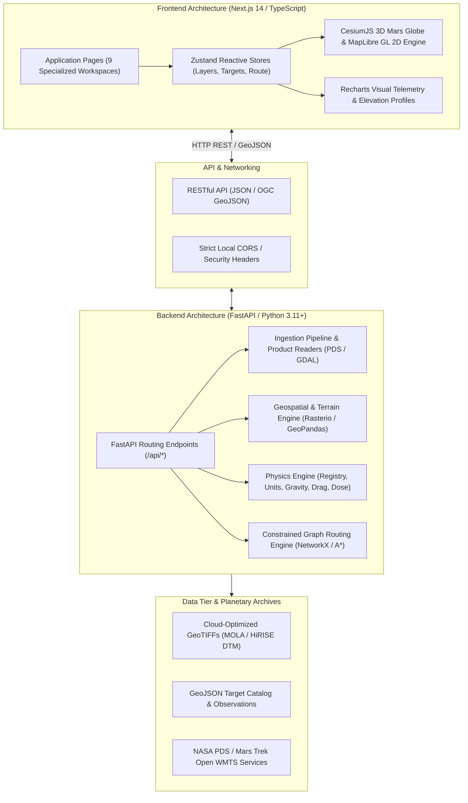

# MARSCOPE Technical Architecture

## 1. System Overview

**MARSCOPE (Martian Surface Intelligence & Exploration System)** is engineered as a decoupled, modern scientific web platform designed for high-resolution planetary data processing, physics-grounded terrain analysis, and constrained route optimization.

---

## 2. Frontend Subsystem (`frontend/`)

- **Next.js & React 18+ (App Router):** High-performance component-driven interface with hybrid rendering. Server components handle static documentation and initial shell delivery, while client components manage interactive 3D viewports and stateful planners.
- **CesiumJS 3D Surface Engine:** Provides a genuine planetary globe configured with the Mars reference ellipsoid (IAU2000:49900). Supports draping HiRISE and CTX orthorectified imagery over 3D terrain meshes.
- **MapLibre GL JS:** High-speed 2D fallback and specialized planar projection viewer for localized traversability overlays and slope gradient heatmaps.
- **Zustand State Management:** Lightweight, zero-boilerplate reactive stores managing:
  - Active map layer visibility and opacity.
  - Selected scientific targets in the mission planning basket.
  - Active calculated route geometry, elevation profile, and telemetry.
- **Design System:** Custom aerospace dark theme built with Tailwind CSS, utilizing high-contrast data visualization palettes compliant with WCAG accessibility standards.

---

## 3. Backend Subsystem (`backend/`)

- **FastAPI Framework:** Asynchronous, self-documenting (OpenAPI / Swagger) Python backend engineered for low-latency spatial and graph queries.
- **Geospatial & Terrain Processing (`app/geospatial`, `app/terrain`):**
  - Uses `GDAL`, `Rasterio`, `Shapely`, and `pyproj` to reproject and clip Martian rasters.
  - Generates derivative rasters: slope (degrees), aspect (radians), and Terrain Ruggedness Index (TRI).
- **Physics Engine (`app/physics`):**
  - Pure, deterministic Python modules strictly enforcing SI units.
  - Versioned parameter registry defining Martian planetary constants.
  - Computes uphill gravitational force components, atmospheric density variations, and cumulative radiation exposures.
- **Traversability & Routing Engine (`app/routing`):**
  - Transforms processed DEM rasters into 8-connected directed spatial graphs.
  - Employs constrained A* and Dijkstra pathfinding incorporating directional slope penalties, roughness factors, and non-negotiable return-to-base consumable reserves.

---

## 4. Data Pipeline & Persistence

- **Local Storage Strategy:** Raw datasets are stored in `datasets/raw/` (git-ignored), processed into Cloud-Optimized GeoTIFFs (COGs) with overviews in `datasets/processed/`, and referenced through JSON catalogs in `datasets/catalog/`.
- **Coordinate Reference System Uniformity:** All incoming datasets are normalized to the standard Mars reference frame (`IAU2000:49900` or local projected equidistant frame centered at Gale Crater: $137.4^\circ\text{ E}, 4.6^\circ\text{ S}$) prior to analysis.
