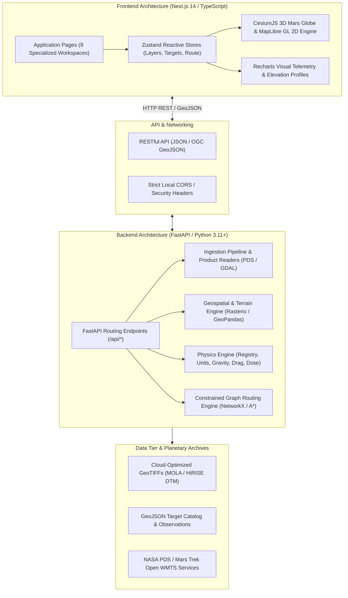

# MARSCOPE Technical Architecture

## 1. System Overview

**MARSCOPE (Martian Surface Intelligence & Exploration System)** is engineered as a decoupled, modern scientific web platform designed for high-resolution planetary data processing, physics-grounded terrain analysis, and constrained route optimization.

---

## 2. Frontend Subsystem (`frontend/`)

- **Next.js & React 18+ (App Router):** High-performance component-driven interface with hybrid rendering. Server components handle static documentation and initial shell delivery, while client components manage interactive 3D viewports and stateful planners.
- **CesiumJS 3D Surface Engine:** Provides a genuine planetary globe configured with the Mars reference ellipsoid (IAU2000:49900). Supports draping HiRISE and CTX orthorectified imagery over 3D terrain meshes.
- **MapLibre GL JS:** High-speed 2D fallback and specialized planar projection viewer for localized traversability overlays and slope gradient heatmaps.
- **Zustand State Management:** Lightweight, zero-boilerplate reactive stores managing:
  - Active map layer visibility and opacity.
  - Selected scientific targets in the mission planning basket.
  - Active calculated route geometry, elevation profile, and telemetry.
- **Design System:** Custom aerospace dark theme built with Tailwind CSS, utilizing high-contrast data visualization palettes compliant with WCAG accessibility standards.

---

## 3. Backend Subsystem (`backend/`)

- **FastAPI Framework:** Asynchronous, self-documenting (OpenAPI / Swagger) Python backend engineered for low-latency spatial and graph queries.
- **Geospatial & Terrain Processing (`app/geospatial`, `app/terrain`):**
  - Uses `GDAL`, `Rasterio`, `Shapely`, and `pyproj` to reproject and clip Martian rasters.
  - Generates derivative rasters: slope (degrees), aspect (radians), and Terrain Ruggedness Index (TRI).
- **Physics Engine (`app/physics`):**
  - Pure, deterministic Python modules strictly enforcing SI units.
  - Versioned parameter registry defining Martian planetary constants.
  - Computes uphill gravitational force components, atmospheric density variations, and cumulative radiation exposures.
- **Traversability & Routing Engine (`app/routing`):**
  - Transforms processed DEM rasters into 8-connected directed spatial graphs.
  - Employs constrained A* and Dijkstra pathfinding incorporating directional slope penalties, roughness factors, and non-negotiable return-to-base consumable reserves.

---

## 4. Data Pipeline & Persistence

- **Local Storage Strategy:** Raw datasets are stored in `datasets/raw/` (git-ignored), processed into Cloud-Optimized GeoTIFFs (COGs) with overviews in `datasets/processed/`, and referenced through JSON catalogs in `datasets/catalog/`.
- **Coordinate Reference System Uniformity:** All incoming datasets are normalized to the standard Mars reference frame (`IAU2000:49900` or local projected equidistant frame centered at Gale Crater: $137.4^\circ\text{ E}, 4.6^\circ\text{ S}$) prior to analysis.

---

## 5. Prompt 4 Scientific Discovery Engine & Spatial Indexing Subsystem

- **PDS3 / PDS4 Schema-Driven Parsing & Coordinate Association (`app/ingestion/pds_label.py`, `app/science/coordinate_association.py`, `app/science/curiosity_parser.py`):** Full ODL nested structure parser (`^STRUCTURE` `.FMT` includes, byte-offset pointers, `ROVER_MOTION_COUNTER`), Gale Equirectangular metric transformation (`R=3,396,190 m`), and JPL `MSL_waypoints.json` RMC joiner.
- **Validation, Uncertainty & Normalization Engine (`app/science/composition/`):** Controlled IUPAC species registry (`species.py`), `wt%`/`ppm` and oxide-to-element stoichiometry (`normalization.py`), uncertainty compatibility registry (`uncertainty.py`) enforcing statistical comparability in `ranking.py`, 12-stage validation pipeline + `RejectionRecord` emitter + `evidence_id_v2` (`validation.py`), and strict schema-enforced adapters (`adapters.py`) for APXS (PDS4 `.XML`), ChemCam MOC/PSV (`.LBL`), CheMin RDR5 (`.LBL`/`.FMT`), CRISM honesty guard, and REMS exclusion.
- **Transaction-Safe Immutable Generation Publication (`app/science/composition/index.py`):** Exclusive `fcntl.flock` (`.publish.lock`) serializes concurrent rebuilds; builds stage inside `generations/.staging_<gen_id>__<nonce>_pid<pid>/` (`journal_mode=DELETE` self-contained SQLite + canonical JSON manifest authenticated by `complete_manifest_digest` vs `source_artifact_digest`), promote to immutable `generations/<gen_id>__<nonce>/`, and atomically swap `active_generation.json` via `os.replace` while retaining `previous_successful_generation_id` and automatically cleaning incomplete staging directories. Readers resolve `(sqlite_path, reproducibility_manifest_path, complete_manifest_digest)` atomically through `active_generation.json` for tear-free concurrent access.
- **Mars Geodesic Discovery & Interactive Globe Sync:** `CompositionSearchService` clusters spatially verified hits into `CandidateDiscoveryLocation`s using `pyproj.Geod` (`IAU2000`), synchronized with CesiumJS clickable markers in `MarsGlobeViewer.tsx`, Minerals Explorer workbench, Target Explorer (`target_status` provenance badge), and Evidence Audit UI.

---

## 6. Prompt 8 Human Mobility Intelligence Engine (`backend/app/mobility/`)

- **Modular Subsystem Architecture:**
  - `models.py` & `schemas.py`: Domain enumerations (`TerrainCoverageState`, `ResolutionSuitabilityLevel`, `AnalysisScaleType`, `ParameterOriginType`, `CellTraversalAvailabilityState`) and Pydantic request/response contracts.
  - `resolution.py`: Resolution suitability evaluator across `regional_elevation_analysis`, `local_slope_analysis`, `regional_roughness_analysis`, and `small_scale_obstacle_detection`.
  - `coverage.py`: 5-state spatial coverage and unknown-data intelligence (`outside_source_footprint`, `inside_footprint_nodata`, `valid_source_data`, `insufficient_resolution_for_analysis`, `derivative_unavailable_invalid_neighborhood`) with spherical surface area integration on $R = 3,396,190\text{ m}$.
  - `terrain_features.py`: Windowed extraction of elevation, Horn `3x3` slope, compass aspect (`[0, 360)` clockwise from North; flat cells undefined), metric TRI roughness, and geodesic 2-point/polyline elevation gain/loss profiles.
  - `mobility_scenario.py`, `traversal_model.py`, `cost_surface.py`: Persisted `MobilityScenarioRegistry` (`datasets/processed/mobility_scenarios.json`), assumption-transparent `TraversalModel` (`transparent_kinematic_v1`), and per-cell `TraversalCostSurface` generator (`CostSurfaceSummary`) preparing validated inputs for future mission planning without performing route optimization.
# 7. Prompt 11 Real 3D Martian Terrain & Science-Aware Routing Architecture

## 7.1 Dual-Engine 3D Terrain Architecture
- **Local High-Resolution 3D Heightfield Mesh Engine (`backend/app/terrain/mesh.py`, `backend/app/api/terrain_mesh.py`):**
  - Samples real NASA PDS/GeoTIFF DEMs (`hirise_dteec_009149_1750`, `hirise_dteec_040770_1755`, `mola_megt00n090hb`) across hierarchical LOD pyramids (`LOD 0`: `1x1` base tile, `LOD 1`: `2x2`, `LOD 2`: `4x4`, `65x65` vertices per tile).
  - Enforces **seam continuity** via deterministic tile edge coordinates so adjacent tiles share bit-identical `(east_m, north_m, elevation_m)` positions, and emits strict `valid_mask` flags (`1` = finite source elevation, `0` = oblique swath or raster NoData) so no-data regions are omitted rather than triangulated as spikes.
  - Converts planetocentric coordinates to metric East-North-Up (ENU) coordinates anchored at dataset center on $R_{\text{eq}} = 3,396,190.0\text{ m}$ (`cos(origin_lat)` longitudinal scaling) and computes analytical Central-Difference surface normals on valid neighbors.
  - Exposes `/api/terrain/mesh/heightgrid` (`HeightGridResponse` with `grid_rows`, `grid_cols`, `elevations_m`, `valid_count`) feeding CesiumJS `HeightmapTerrainData` via `createMarscopeDemTerrainProvider()`, and `/api/terrain/ortho/{dataset_id}/texture` (`ortho`, `elevation`, `slope`, `roughness` PNGs aligned identically to tile geographic bounds).
- **Frontend Three.js Terrain Viewer (`frontend/src/components/LocalTerrain3DViewer.tsx`) & CesiumJS Sync (`frontend/src/components/MarsGlobeViewer.tsx`):**
  - Renders interactive OrbitControls WebGL DEM meshes with `1x True` default scale (`2x`/`3x` O(1) GPU group scaling), synced HiRISE ortho/derivative UVs (`flipY = true`), raycast hover telemetry (`lat`, `lon`, `elev`, `slope`, `TRI`), `Inspect / Set Start / +Waypt / Set Dest` surface picking, camera focus animations, science target pins, and 3D elevated route ribbons (`+0.8 m` surface offset).
  - `/explorer` unifies Three.js (`3D Terrain DEM`), `Split View`, and CesiumJS (`Mars Globe`) over shared Zustand store `useRoutingStore.ts` (`activeRoute`, `startPoint`, `destinationPoint`, `customWaypoints`, `staleRoute`).

## 7.2 Science-Aware Graph Routing Subsystem (`backend/app/routing/`)
- **`models.py` & `schemas.py`:** Defines `RoutingMode` (`conservative`, `balanced`, `science_priority`), `PathAlgorithm` (`astar`, `dijkstra`), `MODE_POLICIES`, and typed request/response contracts (`RouteComputeRequest`, `RouteComputeResponse`, `RouteCompareRequest`, `RouteCompareResponse`).
- **`graph.py`:** Builds `TerrainGrid` dynamically over requested corridor bounds padded cleanly to stay inside valid source coverage, enforces `effective_slope_limit_deg = min(user_max_slope_deg, mode_cap)` (Conservative scales slope limit by `0.80`), enforces strict **no diagonal corner-cutting** across impassable slopes or NoData cells, tracks distance to NoData cells (`nodata_prox`), and integrates local verified composition evidence bonuses within `150 m` (`Science-Priority` positive multiplier floor `>= 0.45` preserving A* admissibility).
- **`pathfinder.py` & `instructions.py`:** Runs deterministic binary-heap A* (with admissible 3D Euclidean lower bound) or Dijkstra, orders intermediate science/custom stops via exact DP/held-karp TSP (`N <= 10`) or nearest-neighbor refinement, runs obstacle-, NoData-, and **3D elevation-chord-tolerance** (`max_vert_dev_m = min(2.5, max(1.0, epsilon_m * 0.4))`) Ramer-Douglas-Peucker simplification (`simplify_leg_safely`), and emits True North `[0, 360)` and Equirectangular Grid North step-by-step instructions.
- **`service.py`:** Coordinates multi-stop planning, optional return-to-start loop, optional user-configured walking speed and EVA budget margins, computes mean/max slope and TRI across **all raw traversed cells** (`leg_res.cells`), invokes `calculate_gravitational_potential_energy` (`phys_res.calculated_value`) when astronaut mass is supplied, stores session routes for GeoJSON export (`/api/routing/{route_id}/geojson`), and feeds `/planner`, `/routes`, `/simulation`, and `/targets`.

## 7.3 NASA Imagery Catalogue Architecture (`backend/app/imagery/`, `/api/imagery/*`)
Product-level image records live alongside `DatasetCatalogService` in `datasets/catalog/imagery_products/catalog.json`, supporting structured PDS Imaging Atlas & ODE searches, size/host-bounded SHA-256 atomic product acquisition, and honest `panorama_eligibility_unverified` guards (no synthetic MSL Navcam panoramas claimed). Isolated Perseverance raw imagery proxy endpoints live under `/api/imagery/perseverance` (`perseverance_gallery.py`).

---

## 8. Prompt 12 Continuous Terrain Rendering, Exact Polylines & Live Tracking Subsystem

- **Seamless Cross-Tile Terrain Mesh & Overlays (`backend/app/terrain/mesh.py`, `frontend/src/components/LocalTerrain3DViewer.tsx`):**
  - `_sample_dem_grid` evaluates `np.linspace` exact tile boundary coordinates with clamped bilinear interpolation across outer 0.5-pixel rims and 1-ring padded central-difference normals (`normals`), eliminating inter-tile creases and corner elevation steps.
  - `render_region_texture_png` applies bilinear ortho subpixel sampling, half-texel UV alignment, and shared manifest `elevation_range_m`/`roughness_range_m` bounds (`vmin`/`vmax`). `LocalTerrain3DViewer` hot-swaps tile materials in-place without recreating geometry or resetting `OrbitControls` cameras, supports `Auto` camera-distance LOD + manual override and optional diagnostic tile borders, and renders computed routes strictly as exact 3D polyline segments (`THREE.BufferGeometry` from `activeRoute.vertices`, no `CatmullRomCurve3` smoothing).
- **Clean-Checkout Honesty & Opt-In Constraints:** `DatasetCatalogService` and `LayerCatalogService` demote missing local files strictly in memory on clean checkouts; routing starts with explicit `null` endpoints, opt-in reserve/return assumptions, debounced cancellable `AbortController` requests, collapsible Alternative Routes drawer, and `provenance` block linking every route to its source DEM.
- **Authenticated Live Telemetry vs Isolated Simulation (`backend/app/services/tracking_service.py`, `/api/tracking/*`, `useTrackingStore.ts`, `app/simulation/page.tsx`):** Strictly separates authenticated `IAU2000:49900` live tracking feeds (`X-Mars-Tracking-Token` / `Authorization: Bearer`, SSE `/stream`, monotonic sequence checks, stale detection, Mars-sphere cross-track deviation, confirmation-gated `/replan-preview`) from `Mission Simulation` (`SIMULATION — NOT LIVE MISSION TELEMETRY`).
