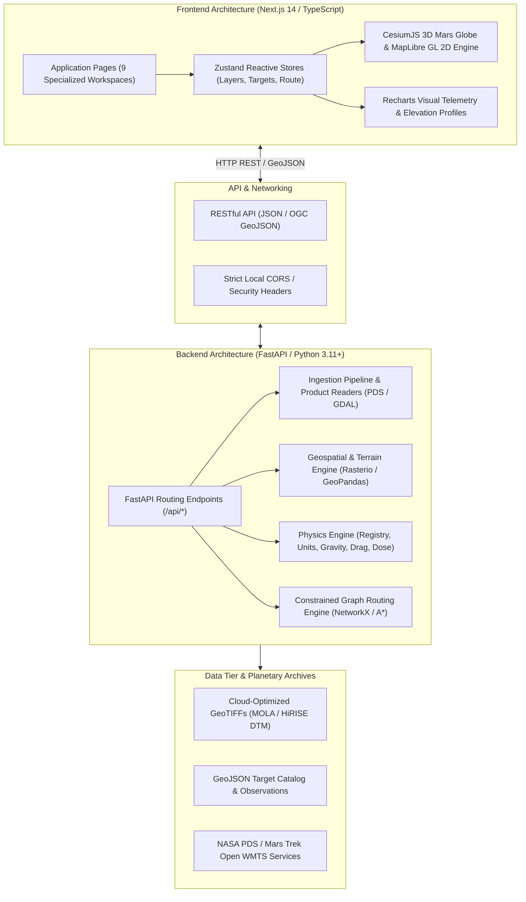

# MARSCOPE Technical Architecture

## 1. System Overview

**MARSCOPE (Martian Surface Intelligence & Exploration System)** is engineered as a decoupled, modern scientific web platform designed for high-resolution planetary data processing, physics-grounded terrain analysis, and constrained route optimization.

---

## 2. Frontend Subsystem (`frontend/`)

- **Next.js & React 18+ (App Router):** High-performance component-driven interface with hybrid rendering. Server components handle static documentation and initial shell delivery, while client components manage interactive 3D viewports and stateful planners.
- **CesiumJS 3D Surface Engine:** Provides a genuine planetary globe configured with the Mars reference ellipsoid (IAU2000:49900). Supports draping HiRISE and CTX orthorectified imagery over 3D terrain meshes.
- **MapLibre GL JS:** High-speed 2D fallback and specialized planar projection viewer for localized traversability overlays and slope gradient heatmaps.
- **Zustand State Management:** Lightweight, zero-boilerplate reactive stores managing:
  - Active map layer visibility and opacity.
  - Selected scientific targets in the mission planning basket.
  - Active calculated route geometry, elevation profile, and telemetry.
- **Design System:** Custom aerospace dark theme built with Tailwind CSS, utilizing high-contrast data visualization palettes compliant with WCAG accessibility standards.

---

## 3. Backend Subsystem (`backend/`)

- **FastAPI Framework:** Asynchronous, self-documenting (OpenAPI / Swagger) Python backend engineered for low-latency spatial and graph queries.
- **Geospatial & Terrain Processing (`app/geospatial`, `app/terrain`):**
  - Uses `GDAL`, `Rasterio`, `Shapely`, and `pyproj` to reproject and clip Martian rasters.
  - Generates derivative rasters: slope (degrees), aspect (radians), and Terrain Ruggedness Index (TRI).
- **Physics Engine (`app/physics`):**
  - Pure, deterministic Python modules strictly enforcing SI units.
  - Versioned parameter registry defining Martian planetary constants.
  - Computes uphill gravitational force components, atmospheric density variations, and cumulative radiation exposures.
- **Traversability & Routing Engine (`app/routing`):**
  - Transforms processed DEM rasters into 8-connected directed spatial graphs.
  - Employs constrained A* and Dijkstra pathfinding incorporating directional slope penalties, roughness factors, and non-negotiable return-to-base consumable reserves.

---

## 4. Data Pipeline & Persistence

- **Local Storage Strategy:** Raw datasets are stored in `datasets/raw/` (git-ignored), processed into Cloud-Optimized GeoTIFFs (COGs) with overviews in `datasets/processed/`, and referenced through JSON catalogs in `datasets/catalog/`.
- **Coordinate Reference System Uniformity:** All incoming datasets are normalized to the standard Mars reference frame (`IAU2000:49900` or local projected equidistant frame centered at Gale Crater: $137.4^\circ\text{ E}, 4.6^\circ\text{ S}$) prior to analysis.

---

## 5. Prompt 4 Scientific Discovery Engine & Spatial Indexing Subsystem

- **PDS3 / PDS4 Schema-Driven Parsing & Coordinate Association (`app/ingestion/pds_label.py`, `app/science/coordinate_association.py`, `app/science/curiosity_parser.py`):** Full ODL nested structure parser (`^STRUCTURE` `.FMT` includes, byte-offset pointers, `ROVER_MOTION_COUNTER`), Gale Equirectangular metric transformation (`R=3,396,190 m`), and JPL `MSL_waypoints.json` RMC joiner.
- **Validation, Uncertainty & Normalization Engine (`app/science/composition/`):** Controlled IUPAC species registry (`species.py`), `wt%`/`ppm` and oxide-to-element stoichiometry (`normalization.py`), uncertainty compatibility registry (`uncertainty.py`) enforcing statistical comparability in `ranking.py`, 12-stage validation pipeline + `RejectionRecord` emitter + `evidence_id_v2` (`validation.py`), and strict schema-enforced adapters (`adapters.py`) for APXS (PDS4 `.XML`), ChemCam MOC/PSV (`.LBL`), CheMin RDR5 (`.LBL`/`.FMT`), CRISM honesty guard, and REMS exclusion.
- **Transaction-Safe Immutable Generation Publication (`app/science/composition/index.py`):** Exclusive `fcntl.flock` (`.publish.lock`) serializes concurrent rebuilds; builds stage inside `generations/.staging_<gen_id>__<nonce>_pid<pid>/` (`journal_mode=DELETE` self-contained SQLite + canonical JSON manifest authenticated by `complete_manifest_digest` vs `source_artifact_digest`), promote to immutable `generations/<gen_id>__<nonce>/`, and atomically swap `active_generation.json` via `os.replace` while retaining `previous_successful_generation_id` and automatically cleaning incomplete staging directories. Readers resolve `(sqlite_path, reproducibility_manifest_path, complete_manifest_digest)` atomically through `active_generation.json` for tear-free concurrent access.
- **Mars Geodesic Discovery & Interactive Globe Sync:** `CompositionSearchService` clusters spatially verified hits into `CandidateDiscoveryLocation`s using `pyproj.Geod` (`IAU2000`), synchronized with CesiumJS clickable markers in `MarsGlobeViewer.tsx`, Minerals Explorer workbench, Target Explorer (`target_status` provenance badge), and Evidence Audit UI.

---

## 6. Prompt 8 Human Mobility Intelligence Engine (`backend/app/mobility/`)

- **Modular Subsystem Architecture:**
  - `models.py` & `schemas.py`: Domain enumerations (`TerrainCoverageState`, `ResolutionSuitabilityLevel`, `AnalysisScaleType`, `ParameterOriginType`, `CellTraversalAvailabilityState`) and Pydantic request/response contracts.
  - `resolution.py`: Resolution suitability evaluator across `regional_elevation_analysis`, `local_slope_analysis`, `regional_roughness_analysis`, and `small_scale_obstacle_detection`.
  - `coverage.py`: 5-state spatial coverage and unknown-data intelligence (`outside_source_footprint`, `inside_footprint_nodata`, `valid_source_data`, `insufficient_resolution_for_analysis`, `derivative_unavailable_invalid_neighborhood`) with spherical surface area integration on $R = 3,396,190\text{ m}$.
  - `terrain_features.py`: Windowed extraction of elevation, Horn `3x3` slope, compass aspect (`[0, 360)` clockwise from North; flat cells undefined), metric TRI roughness, and geodesic 2-point/polyline elevation gain/loss profiles.
  - `mobility_scenario.py`, `traversal_model.py`, `cost_surface.py`: Persisted `MobilityScenarioRegistry` (`datasets/processed/mobility_scenarios.json`), assumption-transparent `TraversalModel` (`transparent_kinematic_v1`), and per-cell `TraversalCostSurface` generator (`CostSurfaceSummary`) preparing validated inputs for future mission planning without performing route optimization.
# Prompt 9 explorer audit status (2026-11-14)

The current frontend remains a Cesium globe with a 3D ellipsoid, 2D and Columbus view morphs, the existing dynamic local/WMTS layer catalog, destination inspection, and composition markers. Request-render mode is enabled; camera telemetry is throttled and computed from Cesium state; marker entities are held in a stable `CustomDataSource` and reconciled by ID. The camera starts globally and Gale is no longer a universal start/focus value. There is not yet a shared four-mode explorer, DEM-derived terrain provider/mesh pipeline, route sketch UI, Navcam image catalog, or panorama viewer. Do not infer these from the existing mobility APIs.

## Imagery catalogue architecture

Product-level image records live alongside (not as a competing registry to) `DatasetCatalogService`. `ImageryArchiveService` queries the PDS Imaging Atlas using bounded structured Elasticsearch requests, normalizes actual archive responses into typed `ImageryProduct` records, and persists a product catalogue under `datasets/catalog/imagery_products/catalog.json`, nested so the dataset-only registry does not misread product records. `AcquisitionService.download_imagery_file` extends the established downloader with streaming, a size cap, atomic writes, MD5 comparison, SHA-256, and refusal to overwrite. Existing `parse_pds3_label` is reused; XML labels are retained and parsed through ElementTree.

Routes are under `/api/imagery`: status, observed dataset IDs, search, ODE search, product metadata, label retrieval, queued acquisition/status, eligibility, panoramas, and coverage. Frontend page `/imagery` displays live archive results and request errors distinctly from successful empty searches. ODE coverage/footprints are not fabricated from Atlas records. Product content assessment, geographic station matching, and camera pose remain future work.
