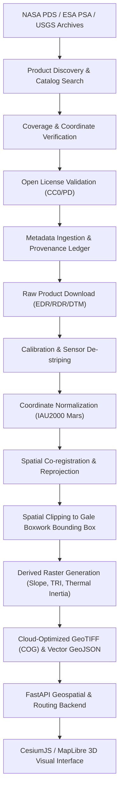

# MARSCOPE: Martian Surface Intelligence & Exploration System
## Master Project Specification & Technical Architecture

---

### Document Information
- **Document Version:** 1.0.0
- **Document Status:** Approved Architecture & Master Source of Truth
- **Project Name:** MARSCOPE
- **Full Designation:** Martian Surface Intelligence & Exploration System
- **Competition:** NASA Space Apps Challenge — *Interplanetary Survival Guide: Martian Map*
- **Target Planetary Body:** Mars (IAU2000:49900 Ellipsoid / D_Mars Sphere Reference)
- **Primary Study Region:** Gale Crater — Mount Sharp / Aeolis Mons (Curiosity Rover Boxwork Exploration Zone)
- **License:** Apache License 2.0 (Open Source Software) / NASA Open Data Policy (Open Scientific Data)

---

## A. Project Identity & Vision

### 1. The Challenge
Exploration of Mars represents one of humanity's greatest scientific and engineering frontiers. However, planning surface extravehicular activities (EVAs or "Marswalks") on the Red Planet presents extreme environmental, physiological, and logistical challenges. Unlike lunar missions, Mars presents a complex dynamic atmosphere, severe hypobaric pressure, cryogenic temperatures, rugged aeolian and impact geomorphology, abrasive regolith, unmitigated cosmic and solar radiation, and immense communication latencies (4 to 24 minutes one-way) that prohibit real-time mission control steering from Earth.

The NASA Space Apps Challenge — *Interplanetary Survival Guide: Martian Map* asks developers and scientists to harness open planetary datasets to build tools that inform and protect future explorers.

### 2. The Mission of MARSCOPE
**MARSCOPE (Martian Surface Intelligence & Exploration System)** is an integrated scientific surface intelligence platform. It fuses open NASA planetary datasets, rigorous raster and vector geospatial processing, physics-based environmental calculations, and constrained graph-optimization algorithms to assist future Martian astronauts, science teams, and EVA flight controllers in planning scientifically optimized, human-aware, and operationally safe surface traverses.

### 3. Core Differentiator: Science-Aware, Human-Aware Route Optimization
Conventional navigation algorithms treat path planning as a geometric minimum-distance or minimum-energy problem across a Digital Elevation Model (DEM). MARSCOPE fundamentally redefines planetary route planning by introducing **Science-Aware, Human-Aware Route Optimization**:
- **Science-Aware:** Traverses are scored not merely by topographic ease, but by the cumulative scientific return of reachable geological targets (e.g., mineralogical transitions, boxwork structural ridges, rover-grounded chemical assays, and stratigraphy).
- **Human-Aware:** Traversability is governed by biophysical constraints, gravity-scaled work expenditure, slope-induced slip hazards, metabolic limits, suit consumables, solar illumination angles, and strict return-to-base reserves that ensure astronauts never cross a point of no return.

### 4. High-Level System Capabilities
1. **Multimodal Planetary Data Fusion:** Seamless co-registration of orbital imagery (HiRISE, CTX), global/regional topography (MOLA, HRSC DEMs), mineralogy (CRISM), thermophysical properties (THEMIS), and in-situ rover observations (Curiosity MSL).
2. **Geomorphological & Hazard Analysis:** Extraction of slopes, terrain ruggedness indices (TRI), aspect, obstacle density, and trafficability costs from high-resolution elevation rasters.
3. **Foundational Physics & Environmental Modeling:** Rigorous Martian gravitational, atmospheric density, uphill work, and radiation exposure calculations with explicit uncertainty bounds.
4. **Constrained Multiobjective Path Planning:** Graph-based pathfinding (A*, Dijkstra) that balances scientific value acquisition against slope resistance, roughness, metabolic cost, and consumable margins.
5. **Full Provenance & Uncertainty Visualization:** Transparent presentation of every dataset's acquisition date, processing level, instrument origin, coordinate reference frame, resolution, and observation limitations.

---

## B. Study Region & Scientific Objective

### 1. Primary Candidate: Gale Crater — Mount Sharp (Aeolis Mons)
- **Geographic Bounds:**
  - Latitude: $-5.5^\circ\text{ S}$ to $-4.3^\circ\text{ S}$
  - Longitude: $137.2^\circ\text{ E}$ to $138.0^\circ\text{ E}$
- **Center Coordinates:** Approximately $4.65^\circ\text{ S}, 137.40^\circ\text{ E}$
- **Geological Setting:** Central mound of Gale Crater (Aeolis Mons / Mount Sharp), specifically focusing on the sulphate-bearing unit and the enigmatic **"boxwork" ridges** investigated by NASA's Mars Science Laboratory (MSL) Curiosity rover.

### 2. Scientific Objective: Ancient Groundwater & Mineralization
The boxwork structures on Mount Sharp represent a premier astrobiological and paleohydrological target on Mars. These interconnected networks of mineralized fractures formed when ancient groundwater circulated through bedrock cracks, depositing erosion-resistant minerals (such as sulfates and silicates). As wind eroded the surrounding softer rock over billions of years, the mineralized veins were left standing as intricate polygonal ridges. 

Investigating this region yields vital clues regarding:
- The longevity and chemical evolution of subsurface groundwater during Mars' transition from a wetter early climate to a hyperarid desert.
- Habitability gradients within ancient subsurface hydrological systems.
- Diagenetic processes and biosignature preservation potential.

### 3. Conceptual Investigation Locations & EVA Waypoints
To ground the traversal simulation in authentic science without fabricating arbitrary locations, waypoints are pinned to validated physical features identified by orbital reconnaissance and Curiosity traverses:
1. **Boxwork Ridge Crests:** Prominent linear and polygonal ridges exhibiting high relief and exposed fracture fills, ideal for structural and petrological sampling.
2. **Inter-Ridge Hollows:** Depressions between ridges characterized by aeolian sand accumulation, loose basaltic soils, and potential rover trafficability hazards.
3. **Geological Transition Zones:** Boundaries between the lower clay-bearing strata, the overlying sulfate-bearing unit, and layered sulfate bedrock, recording global environmental change.
4. **Return-to-Base / Habitat Anchor:** A designated safe landing site / pressurized habitat zone located on relatively flat, hazard-free terrain north of the rugged ridge network.

*Note on Scientific Rigor:* No waypoint coordinates will be invented. Every coordinate used in production must map directly to published Curiosity traverse waypoints (PDS Geosciences Node MSL traverse products) or verified HiRISE orthorectified image coordinates. Overlap between HiRISE DTMs, CTX mosaics, CRISM targeted observations (e.g., FRT0000B242), and MSL in-situ stops must be explicitly validated during the data ingestion pipeline.

---

## C. Open-Source and Open-Data Policy

MARSCOPE strictly enforces an open-science and open-data standard:

### 1. Legal Basis & Licensing
- **Open Scientific Data:** All raw and derived planetary products must have an established open legal basis. NASA planetary science data produced by US Government civil servants and contractors is generally released into the public domain (US Government work) or under Creative Commons CC0 1.0 Universal terms through the NASA Planetary Data System (PDS) and NASA Open Science Data repository. ESA data (e.g., Mars Express HRSC) accessed via the Planetary Science Archive (PSA) is governed by open research reuse policies with mandatory attribution.
- **Open-Source Software:** Every software dependency, runtime component, and library used across the frontend, backend, and build tools must be licensed under standard open-source licenses (MIT, Apache 2.0, BSD-2/3-Clause, ISC, or LGPL/GPL where compatible). Proprietary software, closed SDKs, and commercial mapping engines (e.g., Mapbox commercial tokens, paid Google Maps APIs, proprietary Cesium Ion ion-tokens) are strictly prohibited.

### 2. Dataset Metadata & Provenance Ledger
Every scientific asset ingested into MARSCOPE must be tracked in a structured metadata catalog with the following mandatory fields:
1. **Dataset Name:** Official NASA/ESA title.
2. **Product Identifier:** PDS Product ID or Observation ID (e.g., `ESP_036128_1755`).
3. **Mission & Instrument:** Host spacecraft and sensing instrument (e.g., MRO HiRISE).
4. **License & Terms of Use:** Explicit reuse license (e.g., NASA Public Domain / CC0).
5. **Attribution Requirement:** Formal citation text (e.g., "NASA/JPL-Caltech/University of Arizona").
6. **Acquisition Date / Solar Longitude ($L_s$):** Date and seasonal Martian timestamp.
7. **Processing Level:** Raw (EDR), Calibrated (RDR), Derived (DDR/DTM), or Map Projected.
8. **Coordinate Reference System (CRS):** Mars IAU2000 / IAU2015 projection definition.
9. **Spatial Resolution:** Native pixel pitch (e.g., 0.25 m/px, 128 ppd).
10. **Physical Units:** Radiance, reflectance (I/F), elevation in meters relative to Mars geoid (areoid), temperature in Kelvin.
11. **Geographic Bounding Box:** Min/Max Latitude and Longitude in standard planetary coordinates.
12. **Known Limitations & Uncertainties:** Instrument noise, viewing geometry, atmospheric opacity ($\tau$), or interpolation artifacts.

---

## D. NASA Datasets and Direct Resource Links

MARSCOPE integrates data from the following key NASA and international planetary archives:

### 1. High Resolution Imaging Science Experiment (HiRISE) — MRO
- **Primary Portals:** [https://www.uahirise.org/](https://www.uahirise.org/) | [https://hirise.lpl.arizona.edu/](https://hirise.lpl.arizona.edu/)
- **Purpose:** Sub-meter optical surface imagery (0.25 to 0.5 m/pixel) and stereogrammetrically derived Digital Terrain Models (DTMs, 1 m/pixel). Essential for rock hazard identification, metre-scale slope determination, fracture pattern tracing, and traversability graph generation.

### 2. Context Camera (CTX) — MRO
- **Primary Portals:** [https://ode.rsl.wustl.edu/mars/](https://ode.rsl.wustl.edu/mars/) | [https://pds.nasa.gov/](https://pds.nasa.gov/)
- **Purpose:** Regional optical context imagery at ~6 m/pixel. Bridges the gap between sub-meter HiRISE footprints and regional crater morphology, providing seamless visual context across the Gale Crater study basin.

### 3. Mars Orbiter Laser Altimeter (MOLA) — Mars Global Surveyor (MGS)
- **Primary Portals:** [https://pds-geosciences.wustl.edu/missions/mgs/mola.html](https://pds-geosciences.wustl.edu/missions/mgs/mola.html) | [https://pds-geosciences.wustl.edu/missions/mgs/megdr.html](https://pds-geosciences.wustl.edu/missions/mgs/megdr.html)
- **Purpose:** Global topography and reference areoid (Mission Experiment Gridded Data Record - MEGDR at 128 pixels/degree, ~463 m/pixel). Used as the macro-scale vertical datum and regional terrain boundary. Documented limitation: horizontal resolution is insufficient for local EVA foot hazard detection.

### 4. Compact Reconnaissance Imaging Spectrometer for Mars (CRISM) — MRO
- **Primary Portals:** [https://pds-geosciences.wustl.edu/missions/mro/crism.htm](https://pds-geosciences.wustl.edu/missions/mro/crism.htm) | [https://ode.rsl.wustl.edu/mars/](https://ode.rsl.wustl.edu/mars/)
- **Purpose:** Visible and infrared imaging spectroscopy (0.36 to 3.92 $\mu\text{m}$) at 18 to 36 m/pixel (Targeted Observation Mode). Critical for detecting hydrated mineral phases, sulfates (polyhydrated and monohydrated), phyllosilicates (clays), and iron oxides along Mount Sharp.

### 5. Thermal Emission Imaging System (THEMIS) — Mars Odyssey
- **Primary Portals:** [https://viewer.mars.asu.edu/viewer/themis](https://viewer.mars.asu.edu/viewer/themis) | [https://pds.nasa.gov/](https://pds.nasa.gov/)
- **Purpose:** Multi-band thermal infrared (100 m/pixel) and daytime visual (18 m/pixel). Informs nighttime thermal inertia calculations, which directly correlate with surface physical properties (effective grain size, bedrock exposure vs. fine loose dust).

### 6. Mars Science Laboratory (MSL) Curiosity Rover In-Situ Instruments
- **Primary Portals:** [https://pds-geosciences.wustl.edu/missions/msl/](https://pds-geosciences.wustl.edu/missions/msl/) | [https://science.nasa.gov/mission/msl-curiosity/](https://science.nasa.gov/mission/msl-curiosity/)
- **Instrument Suite & Purpose:**
  - **Mastcam:** Multispectral mast-mounted stereo color imaging; ground-truth panoramas and sedimentology.
  - **MAHLI (Mars Hand Lens Imager):** Microscopic arm-mounted imaging for grain texture and vein mineralogy.
  - **ChemCam (LIBS & RMI):** Laser-induced breakdown spectroscopy for elemental composition of rocks/veins up to 7 m away.
  - **APXS (Alpha Particle X-Ray Spectrometer):** In-situ contact elemental chemistry ($Z \ge 11$).
  - **CheMin (Chemistry and Mineralogy):** X-ray diffraction and fluorescence yielding definitive quantitative mineral phase identifications.
  - **DAN (Dynamic Albedo of Neutrons):** Subsurface hydrogen/water detection in the upper 1 meter of regolith.
  - **RAD (Radiation Assessment Detector):** High-energy particle detector measuring surface cosmic ray and solar energetic particle dose rates.
  - **REMS (Rover Environmental Monitoring Station):** Atmospheric pressure, temperature, wind speed, relative humidity, and UV flux.
  - **Navcam / Hazcam:** Engineering stereo imagery validating localized terrain roughness and wheel slip.

### 7. High Resolution Stereo Camera (HRSC) — Mars Express (ESA)
- **Primary Portals:** [https://www.cosmos.esa.int/web/psa](https://www.cosmos.esa.int/web/psa)
- **Purpose:** Multi-strip color stereophotogrammetric digital elevation models (~50 m/pixel) and orthophotos (~12.5 m/pixel), providing regional elevation consistency across Gale Crater.

### 8. Shallow Subsurface Radar (SHARAD) — MRO
- **Primary Portals:** [https://pds-geosciences.wustl.edu/missions/mro/](https://pds-geosciences.wustl.edu/missions/mro/)
- **Purpose:** High-frequency synthetic aperture radar (15–25 MHz) sounding the upper hundreds of meters of the subsurface. Used for structural stratification context; documented limitation: complex crater wall clutter limits horizontal interpretation in steep topography.

### 9. NASA Mars Trek Planetary Visualization Service
- **Primary Portals:** [https://trek.nasa.gov/mars/](https://trek.nasa.gov/mars/) | [https://trek.nasa.gov/tiles/apidoc/trekAPI.html?body=mars](https://trek.nasa.gov/tiles/apidoc/trekAPI.html?body=mars)
- **Purpose:** Fast exploration via standardized OGC Web Map Tile Services (WMTS). Allows interactive streaming of global Viking mosaics, MOLA hillshades, and CTX/HiRISE footprints. *Specification note:* WMTS services provide high-performance visual reference layers; raw quantitative calculations (e.g. slope, roughness, hydrology) must strictly execute on underlying scientific rasters (GeoTIFF/PDS products).

### 10. NASA Open Data Portals & Authoritative Licensing References
- NASA Planetary Data System: [https://pds.nasa.gov/](https://pds.nasa.gov/)
- NASA Science Data Portal: [https://science.data.nasa.gov/](https://science.data.nasa.gov/)
- NASA Open Science License Policy: [https://science.data.nasa.gov/about/license](https://science.data.nasa.gov/about/license)
- NASA Scientific Information Policy (SMD Information Policy SPD-41a): [https://science.nasa.gov/researchers/science-information-policy_faq/](https://science.nasa.gov/researchers/science-information-policy_faq/)
- US Open Data Initiative: [https://data.nasa.gov/](https://data.nasa.gov/)

---

## E. Physics References & Scientific Equations

### 1. Authoritative Physical Reference Bases
- **NASA Mars Fact Sheet (NSSDC / Goddard Space Flight Center):** [https://nssdc.gsfc.nasa.gov/planetary/factsheet/marsfact.html](https://nssdc.gsfc.nasa.gov/planetary/factsheet/marsfact.html)
- **JPL NAIF SPICE Navigation Architecture:** [https://naif.jpl.nasa.gov/naif/](https://naif.jpl.nasa.gov/naif/)
- **NASA Technical Reports Server (NTRS):** [https://ntrs.nasa.gov/](https://ntrs.nasa.gov/)
- **NASA Technical Standards System:** [https://standards.nasa.gov/](https://standards.nasa.gov/)

### 2. Eight Core Physical Domains
1. **Classical Mechanics:** Kinematics of human and uncrewed mobility across inclined surfaces.
2. **Gravitation:** Planetary surface gravity fields, geopotential variations, and areoid references.
3. **Atmospheric Physics:** Ideal gas law, barometric lapse, scale height ($H \approx 11.1\text{ km}$), and diurnal pressure cycles.
4. **Thermodynamics:** Surface energy balance, radiative equilibrium, thermal inertia, and regolith heat conduction.
5. **Radiation Physics:** Galactic Cosmic Rays (GCR), Solar Energetic Particle (SEP) events, and regolith self-shielding.
6. **Soil & Regolith Mechanics:** Bekker-Wong terramechanics, angle of internal friction ($\phi$), cohesion ($c$), and wheel/boot shear slip.
7. **Human Mobility & Biophysics:** Work expenditure climbing slopes, metabolic heat rejection limits, and life-support consumable depletion rates.
8. **Planetary Geometry:** Martian coordinate ellipsoids (IAU 2000), solar zenith angles, and line-of-sight communications.

### 3. Foundational Mathematical & Physical Formulations

#### 1. Surface Weight & Gravitational Acceleration
$$W = m \cdot g_{\text{Mars}}$$
- Where $m$ is total system mass (astronaut + EVA suit + life support + samples, standard baseline: $m = 80\text{ kg} + 120\text{ kg} = 200\text{ kg}$).
- Standard surface gravity: $g_{\text{Mars}} = 3.72076\text{ m/s}^2$ ($0.3794\,g_{\text{Earth}}$).

#### 2. Gravitational Potential Energy Change
$$\Delta PE = m \cdot g_{\text{Mars}} \cdot \Delta h$$
- Where $\Delta h = h_{\text{final}} - h_{\text{initial}}$ is the vertical elevation change in meters.

#### 3. Topographic Slope Angle
$$\theta = \arctan\left(\sqrt{\left(\frac{\partial z}{\partial x}\right)^2 + \left(\frac{\partial z}{\partial y}\right)^2}\right)$$
- Evaluated via central finite differences or Horn's 3x3 kernel on high-resolution DEM cells of spacing $\Delta x, \Delta y$.

#### 4. Uphill Gravitational Resisting Force
$$F_{\text{gravity\_parallel}} = m \cdot g_{\text{Mars}} \cdot \sin(\theta)$$
- Normal force pressing into regolith: $F_{\text{normal}} = m \cdot g_{\text{Mars}} \cdot \cos(\theta)$.

#### 5. Atmospheric Density Calculation (Ideal Gas Equation of State)
$$\rho = \frac{p}{R_{\text{specific}} \cdot T}$$
- Where $p$ is atmospheric pressure ($\approx 600\text{ to }850\text{ Pa}$ in Gale Crater floor), $T$ is temperature in Kelvin ($\approx 190\text{ to }270\text{ K}$), and $R_{\text{specific}} = \frac{R}{M_{\text{CO}_2}} = \frac{8.31446}{0.04401} \approx 188.92\text{ J/(kg}\cdot\text{K)}$ for pure $\text{CO}_2$ atmosphere. Typical surface density $\rho \approx 0.015\text{ to }0.020\text{ kg/m}^3$.

#### 6. Aerodynamic Drag (Relevant for Storms and Dust Transport)
$$F_d = \frac{1}{2} \rho C_d A v^2$$
- Where $C_d$ is drag coefficient ($\approx 1.0\text{ to }1.2$ for suited explorer), $A$ is frontal cross-sectional area ($\approx 0.8\text{ to }1.0\text{ m}^2$), and $v$ is wind velocity relative to explorer.

#### 7. Simplified Integrated Radiation Dose
$$D_{\text{total}} = \int_0^{t_{\text{traverse}}} \dot{D}_{\text{surface}}(t)\,dt \approx \dot{D}_{\text{nominal}} \cdot \Delta t$$
- Where $\dot{D}_{\text{nominal}}$ is derived from MSL RAD baseline measurements ($\approx 0.2\text{ to }0.25\text{ mSv/day}$ or $\approx 8.3\text{ to }10.4\text{ }\mu\text{Sv/hr}$ under quiet solar conditions).

### 4. Scientific Assumptions, Units, and Model Boundaries
> [!IMPORTANT]
> **Safety and Engineering Disclaimer:** The simplified equations above are implemented strictly for preliminary scientific traverse screening and mission scenario modeling. They do **not** represent an officially certified, flight-qualified astronaut safety envelope or medical-grade life support simulator. Real EVA flight rules demand validated NASA human-spaceflight physiological models, spacesuit joint torque measurements, and dynamic life-support telemetry.

- **Explicit SI Units:** All calculations strictly use SI units (meters $\text{m}$, kilograms $\text{kg}$, seconds $\text{s}$, Pascals $\text{Pa}$, Kelvins $\text{K}$, Joules $\text{J}$, Watts $\text{W}$, Sieverts $\text{Sv}$).
- **Parameter Distinction:** Measured parameters (e.g., MSL REMS daily pressure $p$, RAD dose rate $\dot{D}$) must never be confused with engineering assumptions (e.g., suit mass $120\text{ kg}$, metabolic consumption efficiency).

---

## F. Data Ingestion & Transformation Pipeline



### 1. Planetary Coordinate Reference Systems (CRS)
Unlike Earth systems referenced to WGS84, Martian spatial data relies on IAU cartographic conventions:
- **Mars 2000 Sphere:** Radius $R = 3,396,190\text{ m}$ (often used in simple global projections).
- **Mars 2000 Ellipsoid (IAU2000:49900):** Semi-major axis $a = 3,396,190\text{ m}$, semi-minor axis $b = 3,376,200\text{ m}$.
- **Gale Crater Local Projected Frame:** Equirectangular or Transverse Mercator centered on $137.4^\circ\text{ E}, 4.6^\circ\text{ S}$, with scale factor $k_0 = 1.0$ to eliminate horizontal distance distortions during metric route calculations.

### 2. Raster & Vector Transformation Standards
- **Raster Formats:** PDS IMG/LBL $\rightarrow$ GDAL/Rasterio $\rightarrow$ 32-bit Float GeoTIFF / Cloud Optimized GeoTIFF (COG) with internal overviews.
- **Elevation Datum:** MOLA Areoid 0-datum (gravitational equipotential surface based on Mars gravity field model GMM-2B).
- **Resampling Methods:** Bilinear for continuous elevations; Nearest-Neighbor for categorical geologic units; Cubic/Lanczos for visual panchromatic imagery.
- **Vector Formats:** OGC GeoJSON and GeoPackage with RFC 7946 coordinates normalized to decimal degrees (East-positive, $[-180^\circ, +180^\circ]$ or $[0^\circ, 360^\circ]$ convention explicitly tracked).

---

## G. Physics Engine Architecture

The physics engine is designed as a standalone, deterministic Python package (`backend/app/physics`) decoupled from database and HTTP interfaces:

### 1. Architectural Submodules
- `registry/`: Versioned constants and environmental defaults (Mars planetary mass $6.4171 \times 10^{23}\text{ kg}$, mean radius $3,389,500\text{ m}$, rotational period $88,642.66\text{ s}$, solar irradiance at $1.524\text{ AU} \approx 586\text{ W/m}^2$).
- `units/`: Dimensional analysis and strict conversion utilities (ensuring no imperial or mismatched units enter computation).
- `models/`: Pure functions implementing gravity, kinematics, atmospheric density, uphill resistance, terrain shear strength, and simplified radiation accumulation.
- `uncertainty/`: First-order error propagation (Monte Carlo or analytic differentials) propagating sensor uncertainties (e.g., DEM vertical precision $\pm 0.5\text{ m}$) into derived slopes and energy estimates.

### 2. Validation & Reference-Case Testing
Every physical function must be benchmarked against published NASA reference calculations (e.g., MSL rover climb telemetry, NSSDC atmospheric tables) with automated pytest coverage enforcing zero runtime regressions.

---

## H. Terrain & Routing Engine

### 1. Terrain Property Extraction
From the input Digital Elevation Model $Z(x, y)$, the terrain engine generates multi-band cost layers:
- **Slope Map ($S$):** Gradient expressed in degrees $[0^\circ, 90^\circ]$. Slopes exceeding $20^\circ$ represent severe astronaut slip hazards; slopes $> 30^\circ$ represent impenetrable obstacles (angle of repose for Martian granular regolith).
- **Terrain Ruggedness Index ($R$):** Mean root-square difference between a central cell and its 8 neighboring cells, quantifying micro-roughness.
- **Uncertainty Layer ($U$):** Spatial variation in DEM accuracy, reflecting stereogrammetric correlation confidence or sensor artifact masking.

### 2. Edge Traversability Cost Formulation
For an edge $e = (u, v)$ between adjacent spatial graph nodes $u$ and $v$:
$$C(e) = d(e) \cdot \left[1 + \alpha \cdot S(e) + \beta \cdot R(e) + \gamma \cdot U(e)\right]$$
- Where $d(e)$ is Euclidean metric distance in 3D space: $\sqrt{(x_v - x_u)^2 + (y_v - y_u)^2 + (z_v - z_u)^2}$.
- $S(e)$ is effective directional slope penalty: asymmetric to penalize uphill climbs according to gravitational work while also penalizing steep downhill descents where loose regolith induces uncontrolled sliding.
- $R(e)$ is roughness penalty factor.
- $U(e)$ is uncertainty penalty factor.
- $\alpha, \beta, \gamma$ are tunable dimensionless mission weights.

### 3. Mission Optimization Objective Function
For a candidate path $P = \{e_1, e_2, \dots, e_k\}$ visiting a subset of scientific targets $\mathcal{T}_{\text{visited}} \subset \mathcal{T}$:
$$\text{Maximize: } \quad \sum_{t \in \mathcal{T}_{\text{visited}}} V(t) - \sum_{e \in P} C(e) - \lambda \cdot t_{\text{elapsed}}(P) - \kappa \cdot U(P)$$
Subject to strict hard constraints:
1. **Return-to-Base Reserve:** Consumables remaining at furthest point along traverse must guarantee return:
   $$E_{\text{reserve}} \ge 1.5 \cdot E_{\text{return\_cost}}(v_{\text{current}} \rightarrow v_{\text{base}})$$
2. **Maximum Mission Duration:** $t_{\text{elapsed}}(P) \le t_{\text{max\_EVA}}$ (e.g., standard 6.0-hour limit with mandatory 1.5-hour contingency).
3. **Maximum Slope Threshold:** $\max_{e \in P} \theta(e) < \theta_{\text{critical}}$ ($25^\circ$).
4. **Non-Negotiable Precedence:** Hard safety constraints can **never** be overridden or relaxed by high scientific target scores.

### 4. Planning Modes
- **Conservative Mode:** Minimizes slope, roughness, and radiation; prioritizes maximum safety margins.
- **Balanced Mode:** Standard operational tradeoff between moderate scientific sampling and conservative life-support consumption.
- **Science-Priority Mode:** Optimizes path to intercept high-value geological transitions and boxwork veins, operating close to allowable constraints.

---

## I. Scientific Intelligence

### 1. Scientific Target Ledger
Every science target in the system represents a physically verified geological or mineralogical feature:
- Target ID, canonical name, latitude, longitude, and elevation.
- Geological classification (e.g., *Sulfate-Cemented Boxwork Ridge*, *Inter-Ridge Aeolian Trough*, *Smectite Clay Unit*).
- Grounding provenance: Rover traverse sol number, CheMin mineralogical detection, or CRISM spectral absorption feature (e.g., $1.9\,\mu\text{m}$ and $2.4\,\mu\text{m}$ sulfate absorptions).
- Supporting vs. contradicting evidence ledger.

### 2. Prohibitions on Data Fabrication
> [!CAUTION]
> **Zero Fabrication Policy:** Under no circumstances will MARSCOPE generate synthetic mineral detections, fabricated rover assays, or simulated discovery points disguised as genuine NASA measurements. All target metadata will be derived directly from published peer-reviewed MSL science publications and official PDS mission archives.

---

## J. Application Pages & Functionality

The MARSCOPE web application features 9 unified pages centered around a 3D Martian terrain canvas:

```text
┌────────────────────────────────────────────────────────────────────────┐
│ TOP BAR: Mission Clock (UTC/Sol) | Gale Crater Active Zone | Status: OK │
├───────────┬────────────────────────────────────────────────────────────┤
│ SIDEBAR   │ MAIN VIEWPORT                                              │
│           │                                                            │
│ 1.Overview│  [ Interactive 3D CesiumJS / MapLibre Surface Canvas ]     │
│ 2.Explorer│  - High-Resolution Orbital Layers (HiRISE, CTX, MOLA)      │
│ 3.Terrain │  - Digital Elevation Terrain Contours & Slopes             │
│ 4.Targets │  - Geolocated MSL Rover Observations & Waypoints           │
│ 5.Planner │  - Active Computed Multi-Target Traverse Graph             │
│ 6.Compare │                                                            │
│ 7.Simulate│ ────────────────────────────────────────────────────────── │
│ 8.Evidence│ TELEMETRY / DATA INSPECTOR / ROUTE PROFILE PANEL           │
│ 9.Settings│ Elevation Profile | Slopes | Consumables | Science Value   │
└───────────┴────────────────────────────────────────────────────────────┘
```

### 1. Mission Overview (`/`)
- **Purpose:** Executive command dashboard summarizing the Gale Crater Mount Sharp exploration context, regional status, active environmental conditions, and quick access to mission planning.
- **Components:** Primary mission badge, atmospheric conditions card (REMS pressure/temp), active study area bounding box, summary KPIs (accessible targets, mapped terrain area, available datasets).
- **Interactions:** One-click transition into Surface Explorer or Route Planner.

### 2. Martian Map / Surface Explorer (`/explorer`)
- **Purpose:** The central 3D/2D geospatial workspace of MARSCOPE.
- **Components:** CesiumJS 3D Mars globe with dynamic camera transition to Mount Sharp; layer switcher toggle for HiRISE orthophotos, CTX basemaps, MOLA elevation hillshades, and MSL Curiosity traverse paths.
- **Interactions:** Coordinate readout, zoom/pan/tilt, layer opacity controls, measurement calipers, and point-of-interest inspector.

### 3. Terrain Intelligence (`/terrain`)
- **Purpose:** In-depth geomorphological and traversability inspection.
- **Components:** Slope heatmaps ($0^\circ\text{ to }30^\circ+$), Terrain Ruggedness Index overlays, aspect orientation maps (solar exposure), and cross-sectional elevation profile generator.
- **Interactions:** Draw profile line across boxwork ridges to inspect real-time elevation changes and slope angles.

### 4. Scientific Discovery / Target Explorer (`/targets`)
- **Purpose:** Interactive catalog of verified geological and mineralogical investigation targets.
- **Components:** Filterable target list (boxwork ridges, sulfates, clays, rover stops), target inspection drawer with spectral signatures, in-situ ChemCam/APXS elemental breakdowns, and high-res Mastcam mosaics.
- **Interactions:** Filter by scientific priority, inspect underlying PDS product links, add targets to the Active Mission Planning Basket.

### 5. Mission Planner / Route Planner (`/planner`)
- **Purpose:** Constrained science-aware path generation between habitat base and selected scientific targets.
- **Components:** Origin/destination selector, target inclusion checklist, mode selector (Conservative, Balanced, Science-Priority), EVA duration slider (hours), life-support reserve buffer slider.
- **Interactions:** "Generate Route" trigger invoking backend graph optimization, rendering 3D route polyline with step-by-step waypoint breakdown and return-to-base point-of-no-return marker.

### 6. Route Comparison (`/routes`)
- **Purpose:** Side-by-side comparative analysis of multiple candidate traverse options.
- **Components:** Multi-column comparison matrix displaying total distance, peak slope, cumulative elevation gain/loss, estimated metabolic energy (MJ), science score, and radiation margin across Conservative vs. Balanced vs. Science-Priority routes.
- **Interactions:** Direct export of route waypoints to standard GeoJSON.

### 7. Mission Simulation (`/simulation`)
- **Purpose:** Step-by-step temporal simulation of the astronaut traverse.
- **Components:** Interactive timeline scrubber (Sol timestamp), astronaut position indicator along 3D route, dynamic consumable burn rate graphs (oxygen, battery, cooling water), and sun elevation / shadow projection.
- **Interactions:** Play/pause/scrub simulation; inject simulated hazard warnings (e.g. localized slope slip or telemetry drop).

### 8. Data Sources & Evidence (`/evidence`)
- **Purpose:** Complete data transparency, provenance ledger, and scientific reproducibility index.
- **Components:** Structured dataset registry table detailing every ingested NASA/ESA product ID, acquisition date, processing level, CRS, resolution, and direct PDS download URL.
- **Interactions:** Search and filter by mission/instrument; direct links to official NASA data repositories.

### 9. Settings / Mission Assumptions (`/settings`)
- **Purpose:** Mission engineering configuration and physical parameter registry inspector.
- **Components:** Astronaut + suit total mass ($m$), walking velocity baseline ($v_0$), maximum allowable slope threshold ($\theta_{\text{max}}$), consumable safety buffer factor, and backend API connection status.
- **Interactions:** Edit parameters to test hypothetical mission architectures (e.g., uncrewed pressurized rover vs. suited astronaut).

---

## K. Technology Stack

### 1. Frontend Architecture
- **Framework:** Next.js (App Router, Server & Client Components)
- **Language:** TypeScript (strict mode enabled)
- **Styling:** Tailwind CSS (custom dark aerospace design system with NASA insignia accents)
- **3D Geospatial Engine:** CesiumJS (with native Mars ellipsoid configuration)
- **2D Geospatial Engine:** MapLibre GL JS (for high-performance vector and raster tile manipulation)
- **State Management:** Zustand (reactive stores for active layer toggles, selected targets, and route state)
- **Data Visualization:** Recharts (responsive telemetry and elevation profiles)
- **Icons:** Lucide React

### 2. Backend Architecture
- **Framework:** Python FastAPI (asynchronous, high-performance API)
- **Language:** Python 3.11+
- **Numerical & Scientific Computing:** NumPy, SciPy
- **Geospatial & Planetary Raster Processing:** GDAL, Rasterio, GeoPandas, Shapely, pyproj
- **Graph Optimization & Pathfinding:** NetworkX, SciPy spatial algorithms
- **Image Processing:** OpenCV / scikit-image
- **Validation & Serialization:** Pydantic v2

### 3. Database & Storage Architecture
- **Database:** PostgreSQL with PostGIS extension (for indexed spatial queries)
- **Geospatial Storage:** Cloud-Optimized GeoTIFF (COG), OGC GeoJSON, NetCDF
- **Data Licensing:** Strictly open-source runtime with zero commercial service dependencies

---

## L. Target Directory Structure

```text
Marscope/
├── README.md
├── plan.md
├── DATA_SOURCES.md
├── LICENSE
├── .gitignore
├── .env.example
├── docs/
│   ├── architecture.md
│   ├── data-policy.md
│   ├── scientific-methodology.md
│   ├── physics-models.md
│   ├── api-contracts.md
│   ├── validation-plan.md
│   └── demo-script.md
├── datasets/
│   ├── catalog/
│   ├── raw/
│   ├── processed/
│   └── manifests/
├── frontend/
│   ├── public/
│   └── src/
│       ├── app/
│       ├── components/
│       ├── lib/
│       ├── stores/
│       ├── types/
│       └── styles/
├── backend/
│   └── app/
│       ├── api/
│       ├── ingestion/
│       ├── geospatial/
│       ├── terrain/
│       ├── science/
│       ├── physics/
│       │   ├── registry/
│       │   ├── units/
│       │   ├── models/
│       │   └── uncertainty/
│       ├── routing/
│       ├── mission/
│       ├── schemas/
│       └── services/
├── scripts/
└── tests/
```

---

## M. Backend API Contracts

| Method | Endpoint | Description |
| :--- | :--- | :--- |
| `GET` | `/api/health` | Service health status, version, and dependency check |
| `GET` | `/api/study-area` | Study area metadata, geographic bounds, and datum definitions |
| `GET` | `/api/layers` | Available orbital raster and vector layer catalog |
| `GET` | `/api/observations` | In-situ Curiosity rover observations and chemistry stops |
| `GET` | `/api/targets` | Filterable list of verified scientific targets |
| `GET` | `/api/targets/{target_id}` | Detailed target dossier, spectra, and provenance |
| `GET` | `/api/terrain/summary` | Topographic summary statistics for active study bounds |
| `GET` | `/api/terrain/layers` | Terrain analysis layers (slope, aspect, roughness rasters) |
| `POST` | `/api/routes/plan` | Solves constrained science-aware traverse optimization |
| `POST` | `/api/routes/compare` | Compares multiple routing modes (Conservative, Balanced, Science) |
| `GET` | `/api/missions/{mission_id}` | Retrieves full mission traverse state and waypoints |
| `POST` | `/api/missions` | Creates and persists a new mission configuration |
| `POST` | `/api/missions/{mission_id}/replan` | Dynamically recalculates route given updated constraints |
| `GET` | `/api/sources` | Complete dataset registry with provenance and PDS links |
| `POST` | `/api/observations` | Ingests or registers a verified field observation |

---

## N. Core Data Models

### 1. Dataset Model
Represents an authoritative NASA/ESA planetary product:
- `id`: Unique string slug (e.g., `hirise_esp_036128_1755`)
- `name`: Human-readable dataset name
- `mission`: Spacecraft mission (`MRO`, `MSL`, `MGS`, `Mars Odyssey`, `Mars Express`)
- `instrument`: Sensor designation (`HiRISE`, `CRISM`, `MOLA`, `THEMIS`, etc.)
- `product_id`: Formal PDS archive product identifier
- `license`: Open data license string (`NASA Public Domain / CC0 1.0`)
- `crs`: Coordinate reference system string (`IAU2000:49900`)
- `resolution_meters`: Spatial pixel pitch
- `bounds`: Geographic bounding box `[min_lon, min_lat, max_lon, max_lat]`
- `source_url`: Direct NASA PDS or institutional repository URL

### 2. Observation Model
Represents an in-situ or orbital measurement at a specific geographic point:
- `id`: Unique observation identifier
- `dataset_id`: Foreign key reference to parent Dataset
- `coordinates`: Geographic coordinate `[longitude, latitude, elevation]`
- `timestamp`: UTC and Martian Sol timestamp
- `instrument`: Instrument responsible for the observation
- `measurement_type`: Elemental chemistry, spectral reflectance, atmospheric pressure, dose rate
- `values`: Key-value map of measured physical quantities with explicit SI units
- `uncertainty`: Measurement variance or confidence interval

### 3. ScienceTarget Model
Represents a prioritized scientific investigation target:
- `id`: Target identifier
- `name`: Feature designation (e.g., `Boxwork Ridge Segment Alpha`)
- `coordinates`: Target location `[longitude, latitude, elevation]`
- `geology_type`: Geomorphological classification
- `scientific_value`: Base scientific importance rating $[1.0, 10.0]$
- `associated_observations`: Array of Observation IDs validating the target
- `investigation_priority`: Categorical priority (`Critical`, `High`, `Opportunistic`)

### 4. Route Model
Represents an optimized Martian traverse:
- `id`: Route identifier
- `planning_mode`: `conservative`, `balanced`, or `science_priority`
- `waypoints`: Array of 3D spatial points with intermediate distances and slopes
- `total_distance_meters`: Cumulative traverse length
- `estimated_duration_seconds`: Total EVA duration based on metabolic slope costs
- `cumulative_elevation_gain`: Total ascent in meters
- `peak_slope_degrees`: Maximum slope encountered along path
- `metabolic_energy_joules`: Estimated astronaut work expenditure
- `scientific_value_collected`: Total accumulated target value
- `return_to_base_margin`: Minimum consumable margin remaining at furthest point

### 5. Mission Model
Represents a high-level EVA plan:
- `id`: Unique mission run identifier
- `astronaut_crew_size`: Number of suited crew members
- `equipment_configuration`: Total mass and locomotion mode
- `active_route`: Active primary Route object
- `contingency_routes`: Precomputed abort/return routes
- `environmental_parameters`: REMS atmospheric pressure, RAD radiation baseline

---

## O. Reference 36-Hour Hackathon Execution Schedule

> [!NOTE]
> *Precedence Notice:* The official competition timeline and duration take precedence over this reference schedule. This breakdown provides milestone milestones for balanced team execution.

- **Hours 0–1: Scope, Architecture & Repository Setup**
  Initialize project structure, Git configuration, documentation truth, frontend/backend shells, and API contracts.
- **Hours 1–4: Data Ingestion & Basemap Integration**
  Verify open licenses, harvest Gale Crater/Mount Sharp MOLA and CTX/HiRISE products, configure CesiumJS 3D Mars globe.
- **Hours 4–8: Geospatial & Terrain Processing**
  Process Gale Crater DEM into slope, aspect, and roughness rasters; verify coordinate alignment.
- **Hours 8–12: Scientific Intelligence & Target Curation**
  Ingest MSL Curiosity rover traverses, mineralogical detections (CheMin/CRISM), and boxwork features into structured schemas.
- **Hours 12–18: Physics Engine & Route Planning Algorithms**
  Implement Martian gravity, uphill work, and A*/Dijkstra traversability graph solver with return-to-base reserves.
- **Hours 18–23: Full-Stack Integration & Mission Planner UI**
  Connect frontend route planner to FastAPI routing endpoints; render 3D paths, slope overlays, and elevation profiles.
- **Hours 23–27: Route Comparison, Simulation & Polish**
  Implement side-by-side route comparison, timeline simulation scrubber, and UI styling polish.
- **Hours 27–31: Verification, Automated Testing & Provenance Audit**
  Run unit tests, verify zero fabricated data, audit all PDS source links, test cross-browser rendering.
- **Hours 31–34: Deployment & Staging**
  Deploy containerized backend and frontend web application to accessible staging environment.
- **Hours 34–36: Demonstration Presentation & Final Submission**
  Prepare demo video, presentation slides, and submit repository to NASA Space Apps Challenge portal.

---

## P. Team Roles & Responsibilities (4-Person Team)

1. **Role 1: NASA Planetary Data & Science Specialist**
   - Owns planetary data sourcing (PDS, HiRISE, CRISM, MSL).
   - Validates open licensing, coordinates, spatial resolution, and scientific accuracy.
   - Curates verified boxwork and mineralogical science targets.
2. **Role 2: Geospatial & Physics Systems Engineer**
   - Implements DEM processing, slope/roughness raster generation, and CRS transformations (GDAL/Rasterio).
   - Develops the backend physics engine (gravity, uphill forces, atmospheric density).
   - Ensures rigorous unit conversions and numerical validation.
3. **Role 3: Frontend & 3D Visualization Engineer**
   - Implements Next.js UI, Tailwind aerospace design system, and CesiumJS/MapLibre 3D surface viewer.
   - Builds responsive data inspection drawers, elevation charts, and route comparison matrices.
4. **Role 4: Backend, Routing & Systems Integration Architect**
   - Builds FastAPI backend services, API routing, and Pydantic schemas.
   - Implements graph traversability algorithms (A*, Dijkstra) and return-to-base constraint solver.
   - Manages end-to-end integration, testing, and system deployment.

---

## Q. Validation & Quality Requirements

1. **Dataset Integrity Verification:** Automated check confirming all input rasters are in valid Mars coordinate frames with zero null/unprojected data.
2. **CRS & Projection Verification:** Projection consistency checks ensuring orbital rasters and rover point vectors co-register within $< 1$ meter error.
3. **Unit Validation:** Type-safe checks ensuring zero implicit conversions (e.g., verifying elevation is in meters, pressure in Pascals, angles in degrees/radians).
4. **Physics Reference Benchmarks:** Unit tests verifying calculated gravitational force, potential energy, and atmospheric density match published NASA Fact Sheet values within $0.1\%$ error.
5. **Terrain Processing Unit Tests:** Slope kernel test against known geometric slopes ($0^\circ, 45^\circ, 90^\circ$).
6. **Constraint Solver Verification:** Edge tests proving paths never traverse cells exceeding maximum slope threshold ($\theta > 25^\circ$) and never violate the 1.5x return consumable margin.
7. **End-to-End API Tests:** Automated pytest suite exercising all 15 endpoints with representative payloads.
8. **Frontend Build & Lint Quality:** Zero TypeScript compilation errors, zero ESLint warnings, fully responsive layout.
9. **Missing Data Handling:** Graceful UI degradation and explicit notifications when high-resolution products are unavailable in a specific sub-region.
10. **Clean Restart Guarantee:** Verified clean container or local launch from a fresh clone without manual state interventions.

---

## R. Scope Control & Prohibited Practices

### 1. Essential Core MVP Features (Must Deliver)
- Functional 3D/2D Martian surface viewer centered on Gale Crater.
- Integration of at least three distinct open NASA planetary data products (Topography, Imagery, In-situ rover observations).
- Real DEM processing calculating slope and terrain roughness.
- Structured catalog of verified scientific targets with direct NASA PDS provenance.
- Working graph-based route optimization algorithm honoring slope constraints and return-to-base margins.
- Interactive route comparison between planning modes.
- Complete data sources and provenance transparency page.

### 2. Stretch Features (Implement Only After Core MVP is Stable)
- Automated geological anomaly detection using spectral index ratios.
- Time-varying dynamic solar illumination and shadow raytracing.
- Real-time astronaut first-person terrain perspective.
- Neo4j / RDF geological scientific knowledge graph.

### 3. Strictly Prohibited Practices
- **NO Fabricated NASA Data:** Fabricating spectral bands, inventing coordinates, or manufacturing rover discoveries is grounds for immediate rejection.
- **NO Unvalidated Safety Claims:** Arbitrary numbers must never be labeled as "certified astronaut survival probabilities".
- **NO Hollow Mockups:** Features in the UI must connect to actual backend calculations or transparently indicate "Under Development / Not Integrated".

---

## S. Definition of Done

A development iteration or feature in MARSCOPE is considered **Done** only when:
1. The code is written in clean, idiomatic TypeScript or Python following architectural conventions.
2. All mathematical equations, physical constants, and units cite authoritative NASA or peer-reviewed literature.
3. Every referenced dataset has verified open reuse terms (CC0 / Public Domain / Open Research) and documented PDS provenance.
4. Comprehensive unit tests are implemented and passing cleanly.
5. The feature operates seamlessly within the integrated full-stack environment.
6. User-facing components provide explicit uncertainty bounds and clear empty/missing data states.
7. Code is documented, staged, and pushed to version control with meaningful conventional commit messages.
